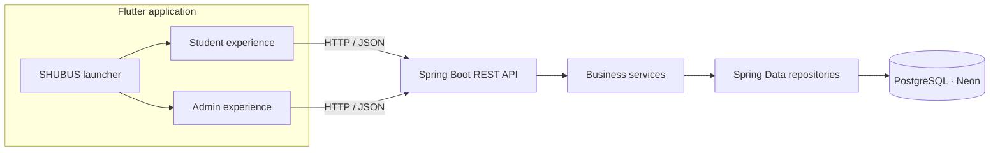

🚌 SHUBUS
Campus shuttle booking, made clearer for every ride.
A connected student reservation and transport administration platform.
  
<!-- HERO IMAGE PLACEHOLDER: add docs/assets/shubus-hero.png — branded app mockups with a campus shuttle backdrop -->

Student App   ·   Admin App   ·   One shared service

A better view of the campus ride
SHUBUS brings shuttle information and reservations into a single mobile experience. Students can check the transport details associated with their profile, explore afternoon route availability, choose an available seat, and manage their booking. Transport administrators can maintain route information and daily assignments, then review schedules and dashboard summaries.

The repository brings the two experiences together through a Flutter launcher. A Spring Boot API provides shared application behavior and connects the clients to PostgreSQL.
One system, two audiences: the Student experience helps riders plan; the Admin experience helps transport staff organize service.

Current service rules
- Bookings for a travel date open at 7:30 PM the previous day and close at 1:45 PM on the travel day (India time).
- Seats are zoned: rows 1-5 for girls, row 6 reserved for admin/staff and unavailable to students, and rows 7-11 for boys. After booking, the student's own seat is highlighted in a read-only bus map.
- Shuttle slots are sequential and can be extended beyond the defaults (Alandur A1-`A5`, Velachery V1-`V3`, Sholinganallur S1, Tambaram T1); the Admin UI supports slots through number 99.
- AC students see AC shuttles (A, V, S); Non-AC students see Non-AC shuttles (T). Regular routes must match the student's transport profile and morning-route eligibility.
The experience
Start in the right place
<!-- SCREEN PLACEHOLDER: docs/screenshots/launcher.png — app selection screen -->

<b>01 · Choose an experience</b> — Enter the Student or Admin app from the SHUBUS launcher.
For students
Students enter through the host application's identity flow and use the registration number supplied to SHUBUS to load their transport profile. The experience is organized around the information and actions needed to plan a ride.
<table>
  <tr>
    <th align="center">Transport profile</th>
    <th align="center">Afternoon routes</th>
    <th align="center">Route details</th>
  </tr>
  <tr>
    <td align="center" valign="top"></td>
    <td align="center" valign="top"></td>
    <td align="center" valign="top"></td>
  </tr>
  <tr>
    <td align="center"><strong>02 · Your transport</strong> Assigned route and transport profile</td>
    <td align="center"><strong>03 · Explore availability</strong> Afternoon service for a selected date</td>
    <td align="center"><strong>04 · Choose a service</strong> Review route and shuttle information</td>
  </tr>
</table><table>
  <tr>
    <th align="center">Seat selection</th>
    <th align="center">Booking confirmation</th>
    <th align="center">My bookings</th>
  </tr>
  <tr>
    <td align="center" valign="top">
      
      
      
      
    </td>
    <td align="center" valign="middle"></td>
    <td align="center" valign="middle"></td>
  </tr>
  <tr>
    <td align="center"><strong>05 · Pick a seat</strong> Available, selected, booked and restricted states</td>
    <td align="center"><strong>06 · Reserve your ride</strong> Booking result and ride details</td>
    <td align="center"><strong>07 · Manage plans</strong> View or cancel a reservation</td>
  </tr>
</table>For transport administrators
The Admin app provides operational tools for route and assignment management. Route records describe services available to the system; date-based afternoon assignments determine what is offered to students. Dashboard and schedule views bring daily operations together.
<table>
  <tr>
    <th align="center">Admin sign in</th>
    <th align="center">Operations dashboard</th>
    <th align="center">Route management</th>
  </tr>
  <tr>
    <td align="center" valign="top"></td>
    <td align="center" valign="top"></td>
    <td align="center" valign="middle"></td>
  </tr>
  <tr>
    <td align="center"><strong>01 · Admin access</strong></td>
    <td align="center"><strong>02 · Daily overview</strong></td>
    <td align="center"><strong>03 · Maintain routes</strong></td>
  </tr>
</table><table>
  <tr>
    <th align="center">Afternoon assignments</th>
    <th align="center">Schedule view</th>
    <th align="center">Assignment editor</th>
  </tr>
  <tr>
    <td align="center" valign="top"></td>
    <td align="center" valign="top">
      
      
    </td>
    <td align="center" valign="top"></td>
  </tr>
  <tr>
    <td align="center"><strong>04 · Organize service</strong></td>
    <td align="center"><strong>05 · Review the day</strong></td>
    <td align="center"><strong>06 · Set route and shuttle slots</strong></td>
  </tr>
</table>Screenshot placeholders: Add images under docs/screenshots/ using the paths above, or change the links to match your image files. Additional empty, loading, validation and success states can help explain the complete experience. Do not use real student personal information in screenshots.

How SHUBUS fits together

<!-- DIAGRAM PLACEHOLDER: docs/assets/system-architecture.png — polished export of the flow above -->The clients present the user experience. The API owns shared workflow rules and persistence operations. Database entities represent persistent records, repositories query them, and services coordinate actions such as availability, booking, and assignment management.
What the system supports
Student services	Administration	Shared platform
Student and transport profile lookup	Admin sign-in and dashboard	Flutter launcher with Student/Admin entry points
Afternoon route availability by date	Route creation and maintenance	Spring Boot REST API
Seat availability and seat selection	Date-specific afternoon assignments	PostgreSQL persistence via Spring Data JPA
Create, view and cancel bookings	Schedule and route operations	Centralized booking, date and shuttle-slot rules

Backend source also includes bus registration and route-to-bus API components. The supplied database reference does not confirm those tables in the live catalog, so they are described as code areas rather than guaranteed deployed schema.
Data at a glance
The documented database is PostgreSQL hosted on Neon. The supplied database reference reports six catalog tables from an earlier export: students, student_transport_profiles, routes, afternoon_route_assignments, bookings, and admin_users. It marks that export as partially verified: several column positions are missing, and bus-related source entities are not confirmed in the catalog.
<!-- DATABASE DIAGRAM PLACEHOLDER: docs/assets/database-erd.png — create only from a current verified schema export -->
See SDC.md for table notes, relationships, known gaps and safe schema verification queries.
Technology
- Mobile and app UI: Flutter / Dart
- API: Java 21, Spring Boot, Spring MVC
- Persistence: Spring Data JPA / Hibernate
- Database: PostgreSQL (Neon deployment reference)
- Client transport: HTTP with JSON payloads
Repository map
SHUBUS-FINAL/
├── frontend/              # Combined launcher application
│   └── lib/                # Entry point and app selection screen
├── frontend-student/       # Student Flutter module
│   └── lib/features/       # Profile, routes, bookings, seats, dashboard
├── frontend-admin/         # Admin Flutter module
│   └── lib/                # Login, dashboard, routes and assignments
└── backend/                # Spring Boot REST API and persistence layer
    └── src/main/java/      # Controllers, DTOs, entities, repositories, services
Project documentation
- [SDC](SDC.md) — detailed technical handover, application/file map, workflows, API contracts, database status, configuration and operations.
- [Database reference](DBREF.md) — the supplied SHUBUS database reference is a partial schema guide. Its definitions should be verified against the intended live database before schema work.
Getting the application running
The combined launcher is in frontend/; the API is in backend/. The backend expects a pre-provisioned PostgreSQL schema and uses environment variables for database connection configuration. Setup details and configuration touchpoints are in SDC.md.

<strong>Local developer quick start</strong>

With Java 21 and Flutter installed, configure SHUBUS_DB_URL, SHUBUS_DB_USERNAME, and SHUBUS_DB_PASSWORD locally, then start the API:
cd backend
.\mvnw.cmd spring-boot:run
Fetch Flutter dependencies and launch the combined app:
cd frontend
flutter pub get
flutter run
The backend example binds to port 8081. The clients' API base URLs must point to an address reachable from the selected device or emulator. Do not commit database credentials.

SHUBUS
Know the service. Choose your ride.

Student reservations and transport operations, connected in one platform.

