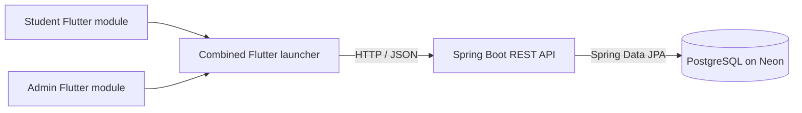

# SHUBUS

> Campus shuttle booking and administration, in one Flutter launcher backed by a Spring Boot API and PostgreSQL.

[](https://flutter.dev/) [](https://spring.io/projects/spring-boot) [](https://www.postgresql.org/) [](https://neon.tech/)

<p align="center"><strong>Student shuttle reservations · Admin operations · Shared transport data</strong></p>

<!-- IMAGE PLACEHOLDER: replace with docs/assets/shubus-hero.png (product banner or campus shuttle photo) -->
<p align="center"></p>

## At a glance

SHUBUS combines student and admin experiences through a launcher. Students can view their transport profile, browse afternoon availability, choose a seat, and manage a booking. Administrators manage routes and afternoon assignments, review operational schedules and dashboard information, and access bus-related administration features exposed by the backend.

> **Repository note:** `frontend/` is the combined launcher; `frontend-student/` and `frontend-admin/` are the Flutter modules it imports. `backend/` contains the REST API. This describes the current workspace, not the older separate-branch VIT EV Buggy architecture in the supplied reference README.

## Product tour

| Student experience | Admin experience |
|---|---|
| <!-- IMAGE PLACEHOLDER: docs/screenshots/student-home.png -->  | <!-- IMAGE PLACEHOLDER: docs/screenshots/admin-dashboard.png -->  |
| <!-- IMAGE PLACEHOLDER: docs/screenshots/student-booking.png -->  | <!-- IMAGE PLACEHOLDER: docs/screenshots/admin-routes.png -->  |

Add screenshots in `docs/screenshots/` and keep these names, or update the links. Until assets are added, the image previews intentionally act as placeholders.

## Architecture



<!-- DIAGRAM PLACEHOLDER: replace Mermaid with exported architecture image if desired (docs/assets/architecture.png) -->

## Repository layout

```text
.
├── frontend/             # Combined Flutter launcher (Student + Admin)
├── frontend-student/     # Student Flutter module
├── frontend-admin/       # Admin Flutter module
└── backend/              # Spring Boot API, JPA entities and repositories
```

## Features represented in this workspace

- Student profile/bootstrap and transport profile lookup.
- Afternoon route availability and seat inventory.
- Create, read and cancel student bookings.
- Admin login, dashboard, route management, schedule and afternoon route assignments.
- Bus registration and route-to-bus API areas are present in backend source; their backing schema must be checked against the live database reference before assuming table details.
- Date-aware booking, operational-day and shuttle-slot rules are implemented in backend utilities/services.

## Getting started

### Prerequisites

- Flutter SDK compatible with Dart `^3.11.5`.
- Java 21 and Maven (or the included Maven wrapper).
- A PostgreSQL database provisioned with the schema expected by the backend. Neon is the documented host.

### Configure the backend

Set `SHUBUS_DB_URL`, `SHUBUS_DB_USERNAME`, and `SHUBUS_DB_PASSWORD` in your local environment. Use `backend/src/main/resources/application.properties.example` as the configuration reference. Never commit real credentials. The example specifies `spring.jpa.hibernate.ddl-auto=none`; the backend expects pre-provisioned database tables.

```powershell
$env:SHUBUS_DB_URL = "jdbc:postgresql://<host>/<database>?sslmode=require"
$env:SHUBUS_DB_USERNAME = "<username>"
$env:SHUBUS_DB_PASSWORD = "<password>"
cd backend
.\mvnw.cmd spring-boot:run
```

The backend listens on port `8081` by default. Configure the Flutter API base URL for the target device/emulator in the relevant `api_config.dart` files before running clients.

### Run the combined Flutter app

```powershell
cd frontend
flutter pub get
flutter run
```

The launcher imports both modules using local path dependencies. Run `flutter pub get` from the launcher directory after dependency changes.

## API and data

The API is organized under `/api`. Important areas include `/api/students`, `/api/students/bookings`, `/api/admin/auth`, `/api/admin/dashboard`, `/api/admin/routes`, `/api/admin/afternoon-routes`, and `/api/admin/schedule`. See [SDC.md](SDC.md) for the controller inventory and implementation notes.

The database reference is **partially verified**, not a complete schema dump. It documents PostgreSQL/Neon and reports six catalog tables: `admin_users`, `afternoon_route_assignments`, `bookings`, `routes`, `student_transport_profiles`, and `students`. It also mentions `buses`, `bus_allowed_routes`, and `mock_bus_registrations` from source notes, but says their presence in the live catalog is unconfirmed. The reference contains missing column positions for some tables. See [SDC.md](SDC.md#database-reference-and-verification-status) before making schema assumptions.

<!-- DIAGRAM PLACEHOLDER: add an ER diagram generated from verified live Neon metadata at docs/assets/database-er.png -->

## Documentation

- [SDC.md](SDC.md) — system and developer documentation, API map, data model status, workflows and operations.
- [Database reference PDF](C:/Users/New/Downloads/SHUBUS_COMPLETE_DATABASE_REFERENCE_FOR_CODEX.pdf) — source supplied for this documentation; local path is specific to its authoring machine.

## Roadmap for project visuals

- [ ] Add hero/banner image: `docs/assets/shubus-hero.png`
- [ ] Add student and admin screenshots under `docs/screenshots/`
- [ ] Export architecture diagram: `docs/assets/architecture.png`
- [ ] Add a database ER diagram only after a complete schema-only export is verified

## Contributing

Keep API contracts and Flutter models in sync. Check the backend entities, services and repositories before changing database assumptions. Use schema-only metadata for documentation; do not add credentials or production data to the repository.

---

<p align="center"><strong>SHUBUS · Make campus transport easier to plan.</strong></p>
