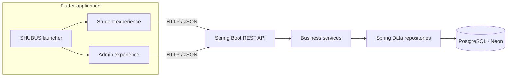

<div align="center">

# 🚌 SHUBUS
### Campus shuttle booking, made clearer for every ride.

**A connected student reservation and transport administration platform.**

[](https://flutter.dev) [](https://spring.io/projects/spring-boot) [](https://neon.tech)

<!-- HERO IMAGE PLACEHOLDER: add docs/assets/shubus-hero.png — branded app mockups with a campus shuttle backdrop -->


**Student App** &nbsp; · &nbsp; **Admin App** &nbsp; · &nbsp; **One shared service**

</div>

---

## A better view of the campus ride

SHUBUS brings shuttle information and reservations into a single mobile experience. Students can check the transport details associated with their profile, explore afternoon route availability, choose an available seat, and manage their booking. Transport administrators can maintain route information and daily assignments, then review schedules and dashboard summaries.

The repository brings the two experiences together through a Flutter launcher. A Spring Boot API provides shared application behavior and connects the clients to PostgreSQL.

> **One system, two audiences:** the Student experience helps riders plan; the Admin experience helps transport staff organize service.

## The experience

### Start in the right place

<!-- SCREEN PLACEHOLDER: docs/screenshots/launcher.png — app selection screen -->
<p align="center"></p>
<p align="center"><sub><b>01 · Choose an experience</b> — Enter the Student or Admin app from the SHUBUS launcher.</sub></p>

### For students

Students enter through the host application's identity flow and use the registration number supplied to SHUBUS to load their transport profile. The experience is organized around the information and actions needed to plan a ride.

| Transport profile | Afternoon routes | Route details |
|:---:|:---:|:---:|
| <!-- SCREEN PLACEHOLDER: docs/screenshots/student-profile.png -->  | <!-- SCREEN PLACEHOLDER: docs/screenshots/student-routes.png -->  | <!-- SCREEN PLACEHOLDER: docs/screenshots/student-route-details.png -->  |
| **02 · Your transport**<br>Assigned route and transport profile | **03 · Explore availability**<br>Afternoon service for a selected date | **04 · Choose a service**<br>Review route and shuttle information |

| Seat selection | Booking confirmation | My bookings |
|:---:|:---:|:---:|
| <!-- SCREEN PLACEHOLDER: docs/screenshots/student-seats.png -->  | <!-- SCREEN PLACEHOLDER: docs/screenshots/student-confirmation.png -->  | <!-- SCREEN PLACEHOLDER: docs/screenshots/student-bookings.png -->  |
| **05 · Pick a seat**<br>Available, selected, booked and restricted states | **06 · Reserve your ride**<br>Booking result and ride details | **07 · Manage plans**<br>View or cancel a reservation |

### For transport administrators

The Admin app provides operational tools for route and assignment management. Route records describe services available to the system; date-based afternoon assignments determine what is offered to students. Dashboard and schedule views bring daily operations together.

| Admin sign in | Operations dashboard | Route management |
|:---:|:---:|:---:|
| <!-- SCREEN PLACEHOLDER: docs/screenshots/admin-login.png -->  | <!-- SCREEN PLACEHOLDER: docs/screenshots/admin-dashboard.png -->  | <!-- SCREEN PLACEHOLDER: docs/screenshots/admin-routes.png -->  |
| **01 · Admin access** | **02 · Daily overview** | **03 · Maintain routes** |

| Afternoon assignments | Schedule view | Assignment editor |
|:---:|:---:|:---:|
| <!-- SCREEN PLACEHOLDER: docs/screenshots/admin-assignments.png -->  | <!-- SCREEN PLACEHOLDER: docs/screenshots/admin-schedule.png -->  | <!-- SCREEN PLACEHOLDER: docs/screenshots/admin-assignment-editor.png -->  |
| **04 · Organize service** | **05 · Review the day** | **06 · Set route and shuttle slots** |

> **Screenshot placeholders:** Add images under `docs/screenshots/` using the paths above, or change the links to match your image files. Additional empty, loading, validation and success states can help explain the complete experience. Do not use real student personal information in screenshots.

## How SHUBUS fits together



<!-- DIAGRAM PLACEHOLDER: docs/assets/system-architecture.png — polished export of the flow above -->

The clients present the user experience. The API owns shared workflow rules and persistence operations. Database entities represent persistent records, repositories query them, and services coordinate actions such as availability, booking, and assignment management.

## What the system supports

| Student services | Administration | Shared platform |
|---|---|---|
| Student and transport profile lookup | Admin sign-in and dashboard | Flutter launcher with Student/Admin entry points |
| Afternoon route availability by date | Route creation and maintenance | Spring Boot REST API |
| Seat availability and seat selection | Date-specific afternoon assignments | PostgreSQL persistence via Spring Data JPA |
| Create, view and cancel bookings | Schedule and route operations | Centralized booking, date and shuttle-slot rules |

Backend source also includes bus registration and route-to-bus API components. The supplied database reference does not confirm those tables in the live catalog, so they are described as code areas rather than guaranteed deployed schema.

## Data at a glance

The documented database is PostgreSQL hosted on Neon. The supplied database reference reports six catalog tables from an earlier export: `students`, `student_transport_profiles`, `routes`, `afternoon_route_assignments`, `bookings`, and `admin_users`. It marks that export as **partially verified**: several column positions are missing, and bus-related source entities are not confirmed in the catalog.

<!-- DATABASE DIAGRAM PLACEHOLDER: docs/assets/database-erd.png — create only from a current verified schema export -->

See [SDC.md](SDC.md#database-reference-and-data-model) for table notes, relationships, known gaps and safe schema verification queries.

## Technology

- **Mobile and app UI:** Flutter / Dart
- **API:** Java 21, Spring Boot, Spring MVC
- **Persistence:** Spring Data JPA / Hibernate
- **Database:** PostgreSQL (Neon deployment reference)
- **Client transport:** HTTP with JSON payloads

## Repository map

```text
SHUBUS-FINAL/
├── frontend/              # Combined launcher application
│   └── lib/                # Entry point and app selection screen
├── frontend-student/       # Student Flutter module
│   └── lib/features/       # Profile, routes, bookings, seats, dashboard
├── frontend-admin/         # Admin Flutter module
│   └── lib/                # Login, dashboard, routes and assignments
└── backend/                # Spring Boot REST API and persistence layer
    └── src/main/java/      # Controllers, DTOs, entities, repositories, services
```

## Project documentation

- **[SDC](SDC.md)** — detailed technical handover, application/file map, workflows, API contracts, database status, configuration and operations.
- **[Database reference](DBREF.md)** — the supplied SHUBUS database reference is a partial schema guide. Its definitions should be verified against the intended live database before schema work.

## Getting the application running

The combined launcher is in `frontend/`; the API is in `backend/`. The backend expects a pre-provisioned PostgreSQL schema and uses environment variables for database connection configuration. Setup details and configuration touchpoints are in [SDC.md](SDC.md#local-development-and-configuration).

<details>
<summary><strong>Local developer quick start</strong></summary>

With Java 21 and Flutter installed, configure `SHUBUS_DB_URL`, `SHUBUS_DB_USERNAME`, and `SHUBUS_DB_PASSWORD` locally, then start the API:

```powershell
cd backend
.\mvnw.cmd spring-boot:run
```

Fetch Flutter dependencies and launch the combined app:

```powershell
cd frontend
flutter pub get
flutter run
```

The backend example binds to port `8081`. The clients' API base URLs must point to an address reachable from the selected device or emulator. Do not commit database credentials.

</details>

---

<div align="center">

### SHUBUS
**Know the service. Choose your ride.**

*Student reservations and transport operations, connected in one platform.*

</div>
