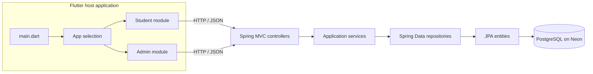
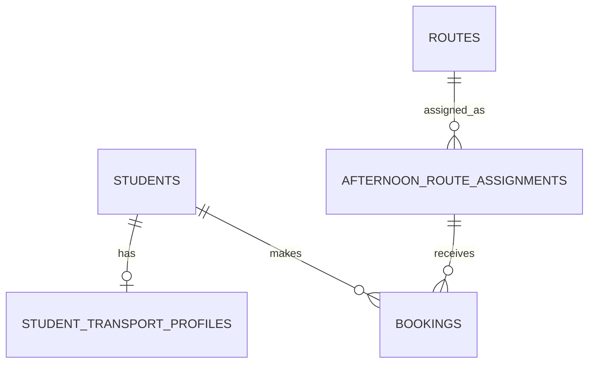

# SHUBUS — System Development & Configuration

> Repository handover guide for developers taking ownership of SHUBUS. This document explains the product, modules, source layout, data flow, API surface, business rules, database evidence, configuration and operational concerns. It describes the workspace currently present in this repository.

## Contents

1. [Purpose and scope](#1-purpose-and-scope)
2. [System architecture](#2-system-architecture)
3. [Repository and package map](#3-repository-and-package-map)
4. [Student application](#4-student-application)
5. [Admin application](#5-admin-application)
6. [Backend design](#6-backend-design)
7. [End-to-end workflows](#7-end-to-end-workflows)
8. [REST API reference](#8-rest-api-reference)
9. [Database reference and data model](#9-database-reference-and-data-model)
10. [Business and date rules](#10-business-and-date-rules)
11. [Local development and configuration](#11-local-development-and-configuration)
12. [Security and privacy](#12-security-and-privacy)
13. [Operations and troubleshooting](#13-operations-and-troubleshooting)
14. [Handover guide by change type](#14-handover-guide-by-change-type)
15. [Known verification gaps](#15-known-verification-gaps)

## 1. Purpose and scope

SHUBUS is a campus shuttle planning and booking system. It gives students a way to inspect transport information and reserve a seat for an afternoon service. It gives transport administrators tools to manage routes and dated afternoon assignments, and to inspect schedule and dashboard information.

This repository contains four cooperating parts:

| Part | Location | Role |
|---|---|---|
| Combined Flutter host | `frontend/` | App entry point and Student/Admin selector |
| Student Flutter module | `frontend-student/` | Student profile, routes, seats and booking experience |
| Admin Flutter module | `frontend-admin/` | Admin login, dashboard, routes and assignments |
| REST backend | `backend/` | API, business rules, persistence and integration with PostgreSQL |

The host app depends on the two feature packages through local path dependencies. They are modules in one launcher in this workspace; they are not represented here as separate Git branches.

The supplied README and SDC references describe a different Firebase-based EV Buggy project. Their structure and visual-documentation ideas are useful as a format reference, but their branch model, database and application behavior do not describe this repository.

## 2. System architecture



### Request path

1. A screen calls a client repository or service.
2. The client networking layer builds an HTTP request using the configured API base URL.
3. A Spring controller parses route parameters, query parameters or a DTO request body.
4. A service applies workflow and business rules.
5. A Spring Data repository reads or writes JPA entities.
6. The controller returns a DTO or HTTP status; Flutter maps that response into models and UI state.

No Firebase or realtime database is part of the current architecture. Client/server updates are request/response HTTP calls.

## 3. Repository and package map

```text
frontend/
  lib/main.dart                         Flutter application entry point
  lib/app_selection/app_selection_screen.dart
                                       Presents Student and Admin entry choices
  pubspec.yaml                          Host package and local module dependencies

frontend-student/
  lib/app/                              Student app composition and theme
  lib/core/config/                      API base URL configuration
  lib/core/network/                     HTTP client and response handling
  lib/core/errors/                      Client-side application exception
  lib/core/utils/                       Booking-window presentation helper
  lib/core/widgets/                     Shared loading/error/empty states
  lib/features/auth/                    Login models and student login screen
  lib/features/dashboard/               Student dashboard and navigation shell
  lib/features/profile/                 Student/transport profile UI and models
  lib/features/routes/                  Route discovery UI and response models
  lib/features/seat_selection/          Seat UI, layout and seat state
  lib/features/bookings/                Booking list/actions and models
  lib/features/student_repository.dart   Student API orchestration

frontend-admin/
  lib/admin_app.dart                     Admin app composition and theme
  lib/services/api_config.dart           Admin API base URL
  lib/services/route_service.dart        Admin API calls
  lib/models/route_model.dart            Route response model
  lib/screens/admin_login_screen.dart    Admin login UI
  lib/screens/admin_dashboard_screen.dart Dashboard/operations UI
  lib/screens/routes_screen.dart         Route maintenance UI
  lib/screens/afternoon_assignment_screen.dart
                                        Date-based assignment UI
  lib/widgets/route_form.dart            Route create/edit form

backend/src/main/java/com/shubus/backend/
  BackendApplication.java                Spring Boot entry point
  HealthController.java                  Health endpoint
  config/SecurityConfig.java              Web/security configuration
  controller/                             REST endpoint adapters
  dto/                                    API request and response shapes
  model/                                  JPA persistence entities
  repository/                             Spring Data database access
  service/                                Business workflows
  util/                                   Shared date, seat and slot rules
  PasswordGenerator.java                  Password-related utility
backend/src/main/resources/
  application.properties.example          Safe configuration template
```

The backend Maven build and Java version are defined in `backend/pom.xml`. The Flutter package names and local module links are in each `pubspec.yaml`.

## 4. Student application

### Composition and navigation

`frontend-student/lib/app/app.dart` composes the Student application. `app/theme/app_theme.dart` supplies its visual theme. `dashboard/student_shell.dart` provides the primary navigation shell; `student_dashboard_screen.dart` is the dashboard feature entry.

### Identity and profile

`features/auth/` contains student login UI and auth models. The host integration can supply a registration number to the Student module; the backend profile endpoint is explicitly described as a bootstrap path that does not require the student to log in again inside SHUBUS. `student_repository.dart` coordinates student API operations. `profile/` contains transport profile models and the profile screen.

The profile response combines student identity/status with morning route number/name and AC type. Profile access is rejected by the backend when the student is inactive or the transport profile is missing.

### Route discovery and reservations

`features/routes/` contains afternoon route models and the route selection screen. The backend filters available route assignments for a student and requested date, using assignment type, shuttle grouping and route eligibility.

`features/seat_selection/seat_selection_screen.dart` handles seat selection and booking interaction. After a successful booking, it shows the student's booking details and a read-only seat map with the booked seat highlighted. `seat_layout.dart` defines the client visual layout and state distinctions: available, selected, booked, reserved, and gender restricted. The server remains authoritative for whether a seat can be booked; client state should not be treated as a reservation lock.

`features/bookings/` displays booking data and supports retrieval/cancellation. A booking is associated with a student, date, afternoon assignment and seat number in the persistence model.

### Networking and UI support

`core/network/api_client.dart` is the shared HTTP client. `core/config/api_config.dart` defines the Student API endpoint configuration. `core/errors/app_exception.dart` gives the UI a common error representation, and `core/widgets/status_views.dart` centralizes status/empty/error presentations.

`core/utils/booking_window.dart` is a client helper for presenting booking-window state. The backend `BookingTimeRules` is authoritative for accepting a booking.

## 5. Admin application

`frontend-admin/lib/admin_app.dart` composes the Admin module and theme. `admin_login_screen.dart` handles admin credential entry. `admin_dashboard_screen.dart` displays operational summary. `routes_screen.dart` lists and manages routes, while `route_form.dart` is the route creation/editing form. `afternoon_assignment_screen.dart` handles date-based afternoon service assignment. The admin-side data calls live in `services/route_service.dart`, with the service base URL in `services/api_config.dart`; `models/route_model.dart` represents route response data.

On the backend, route CRUD is handled by `RouteController`. Afternoon assignments are managed by `AfternoonRouteAssignmentController`, including individual and bulk creation, update, deletion, date/range listing, duplicate checks and shuttle slot validation. `AdminDashboardController` serves the date-specific summary and operational date. `AfternoonScheduleController` and its service/repository provide schedule output.

The Admin login response includes employee ID, active status and a message. The existence of a login endpoint does not, by itself, prove that all admin routes require an authenticated token. Consult `SecurityConfig` and the current request handling when evaluating access control.

## 6. Backend design

### Controllers

Controllers translate HTTP requests into service operations and responses. Main controller groups include student/auth/profile/booking/seat/afternoon route endpoints, admin authentication/dashboard/route/assignment/schedule endpoints, and bus/registration endpoints.

`GlobalExceptionHandler` centralizes exception-to-HTTP response mapping. Controllers should stay focused on transport-level validation and response construction; multi-step workflow logic belongs in services.

### Services

| Service | Responsibility |
|---|---|
| `AuthService` | Student credential verification |
| `AdminAuthService` | Admin credential verification |
| `BookingService` | Create, find and cancel a booking; enforce booking conditions |
| `SeatService` | Resolve seat layout, restrictions and current availability |
| `ShuttleAvailabilityService` | Assess shuttle slot availability/capacity |
| `StudentAfternoonRouteService` | Return date-specific routes available to a student |
| `AfternoonScheduleService` | Produce schedule information |
| `AdminDashboardService` | Assemble dashboard data for a date |
| `PasswordGenerator` | Password-related helper, alongside the top-level utility class |

### Models, DTOs and repositories

Models map persisted records and relationships. DTOs define the public API contract; they prevent an entity's entire persistence shape from becoming an accidental API. Repositories encapsulate queries. For API changes, inspect the controller, service, DTO, repository and Flutter parser together.

### Utilities

- `BookingTimeRules`: booking open/close interval in `Asia/Kolkata`.
- `OperationalDateRules`: determines which service date is operational now.
- `SeatLayout`: canonical server-side seat positions and bookable count.
- `ShuttleSlotRules`: normalizes supported shuttle groups/slots and sequence capacity rules.

## 7. End-to-end workflows

### Student profile bootstrap

```text
Host app provides registration number
  → StudentRepository / ApiClient
  → GET /api/students/{regNo}/profile
  → StudentController checks student and active status
  → transport profile repository lookup
  → StudentProfileResponse
  → profile/dashboard screens
```

### Afternoon route and seat discovery

```text
Student chooses service date
  → GET /api/students/{regNo}/afternoon-routes?date=...
  → StudentAfternoonRouteService combines student eligibility,
    dated assignments and shuttle availability
  → Student selects assignment
  → GET /api/students/{regNo}/afternoon-routes/{assignmentId}/seats?date=...
  → SeatService returns seat states
  → client presents selectable/restricted/booked seats
```

### Booking and cancellation

```text
Student confirms selected assignment, date and seat
  → POST /api/students/bookings
  → BookingService validates request, 19:30 previous-day opening,
    13:45 travel-day cutoff and booking conflicts
  → repository persists booking
  → BookingResponse returned and the Student UI shows the booked-seat view

Student requests cancellation
  → DELETE /api/students/{regNo}/bookings/{bookingId}
  → BookingService verifies ownership and the travel-day 13:45 cutoff
  → booking row is deleted
```

### Admin assignment lifecycle

```text
Admin selects date and routes
  → POST /api/admin/afternoon-routes or /bulk
  → controller validates REGULAR/SHUTTLE and shuttle group
  → route/date duplicate checks
  → assignment rows saved
  → Student route availability can use the dated assignments
```

Updating an assignment changes its type/group. Deleting a shuttle assignment triggers slot compaction in the controller implementation. This behavior is important because later slots form a sequence.

## 8. REST API reference

All paths below are inferred from current controller annotations. Request/response field detail should be taken from the linked DTOs and current controller/service implementation.

### Health and authentication

| Method | Path | Controller | Purpose |
|---|---|---|---|
| GET | `/api/health` | `HealthController` | Service health response |
| POST | `/api/auth/login` | `AuthController` | Student authentication |
| POST | `/api/admin/auth/login` | `AdminAuthController` | Admin authentication |

### Student

| Method | Path | Purpose |
|---|---|---|
| GET | `/api/students/{regNo}` | Basic student details |
| GET | `/api/students/{regNo}/profile` | Bootstrap profile with active-state check |
| GET | `/api/students/{regNo}/transport-profile` | Student transport profile |
| GET | `/api/students/{regNo}/afternoon-routes?date=YYYY-MM-DD` | Date-specific afternoon choices |
| GET | `/api/students/{regNo}/afternoon-routes/{assignmentId}/seats?date=YYYY-MM-DD` | Seat availability for an assignment/date |
| POST | `/api/students/bookings` | Create booking from `BookingRequest` |
| GET | `/api/students/{regNo}/bookings?date=YYYY-MM-DD` | Retrieve the student's booking for a date |
| DELETE | `/api/students/{regNo}/bookings/{bookingId}` | Cancel booking |

### Admin

| Method | Path | Purpose |
|---|---|---|
| GET | `/api/admin/dashboard/operational-date` | Get current operational date |
| GET | `/api/admin/dashboard?date=YYYY-MM-DD` | Date-specific dashboard summary |
| GET/POST/PUT/DELETE | `/api/admin/routes[/{id}]` | Route listing and maintenance |
| GET | `/api/admin/afternoon-routes?date=...` | Assignments by date or date range |
| POST | `/api/admin/afternoon-routes` | Create one assignment via request parameters |
| POST | `/api/admin/afternoon-routes/bulk` | Create several route assignments |
| PUT/DELETE | `/api/admin/afternoon-routes/{id}` | Update or delete assignment |
| GET | `/api/admin/schedule` | Schedule data (check controller for query parameters) |

### Bus/registration API areas

The source includes `BusController`, `RouteBusController`, and `BusRegistrationController`; the supplied database reference does not verify that the related tables exist in the current deployed schema. Check these controllers for exact paths and inspect the live schema before relying on their production availability.

## 9. Database reference and data model

### Evidence and confidence

The supplied [DBREF.md](DBREF.md) identifies PostgreSQL on Neon and Spring Boot/JPA. It labels its inventory **PARTIALLY VERIFIED** and says it combines a recent `information_schema` column export with older catalog notes. It is not a complete schema dump. A missing field in that export is unknown, not proof the field is absent. This SDC does not claim live database access or use the reference as a substitute for current metadata.

The example backend configuration sets `spring.jpa.hibernate.ddl-auto=none`; the app should not be expected to create or migrate missing schema automatically.

### Tables reported in the catalog notes

| Table | Role | Column information reported |
|---|---|---|
| `students` | Student identity/account | `id`, `reg_no`, `name`, `password_hash`, `active`, `gender`; `id` sequence-backed in the supplied export; `active` defaults true |
| `student_transport_profiles` | Student's morning transport assignment | `id`, `student_id`, `morning_route_number`, `morning_route_name`, `ac_type`; ordinal position 5 missing in supplied export |
| `routes` | Route/service definitions | `id`, `route_number`, `route_name`, `ac_type`, `allowed_routes` (`varchar[]`), `default_afternoon`, `route_code`; some defaults reported |
| `afternoon_route_assignments` | Date-specific route/service assignments | `id`, `route_id`, `assignment_date`, `assignment_type`, nullable `shuttle_group` |
| `bookings` | Student seat reservation | Known fields include `id`, `student_id`, `booking_date`, `seat_number`, `booked_at`, `afternoon_assignment_id`; ordinal positions 3, 6 and 8 missing |
| `admin_users` | Admin credentials and active state | `id`, `emp_id`, `password_hash`, `active`; active defaults true |

This is a summary, not a complete DDL. Exact varchar lengths, identifier generation, all nullability, indexes and missing columns must be confirmed from live metadata.

### Relationships/constraints reported by historical notes

The [database reference](DBREF.md) reports the following earlier catalog observations, to be rechecked:

- `afternoon_route_assignments.route_id` references `routes.id` with delete restriction.
- `bookings.student_id` references `students.id` with delete restriction.
- `student_transport_profiles.student_id` references `students.id` with cascade delete.
- The FK from `bookings.afternoon_assignment_id` was not confirmed.
- Unique constraints were reported for `admin_users.emp_id`, `students.reg_no`, one transport profile per student, route number/code, assignment date plus route, seat per assignment/date, and one booking per student/date.

Constraint and index names in [DBREF.md](DBREF.md) are historical observations; verify current definitions before changing code or schema.

### Bus-related mappings not confirmed in the catalog

JPA models and repository code include `Bus`, `BusAllowedRoute`, `BusAllowedRouteId`, and `MockBusRegistration`. [DBREF.md](DBREF.md) says `buses`, `bus_allowed_routes` and `mock_bus_registrations` were referenced by source notes but absent from the six-table catalog export. Their deployment state and exact schema remain unverified.

### Conceptual relationship view



This is a conceptual view of application relationships and reported schema notes, not a verified ERD. The booking-to-assignment FK is specifically unconfirmed in the supplied reference.

<!-- ERD IMAGE PLACEHOLDER: replace conceptual diagram with docs/assets/database-erd.png from complete verified metadata -->

### Read-only schema inspection

Run against the intended Neon database to establish authoritative table, column and constraint facts. These statements inspect metadata only.

```sql
SELECT table_schema, table_name
FROM information_schema.tables
WHERE table_type = 'BASE TABLE'
  AND table_schema NOT IN ('pg_catalog', 'information_schema')
ORDER BY table_schema, table_name;

SELECT table_schema, table_name, ordinal_position, column_name,
       data_type, udt_name, is_nullable, column_default
FROM information_schema.columns
WHERE table_schema NOT IN ('pg_catalog', 'information_schema')
ORDER BY table_schema, table_name, ordinal_position;

SELECT ns.nspname AS schema_name, tbl.relname AS table_name,
       con.conname AS constraint_name, con.contype AS constraint_type,
       pg_get_constraintdef(con.oid, true) AS definition
FROM pg_constraint con
JOIN pg_class tbl ON tbl.oid = con.conrelid
JOIN pg_namespace ns ON ns.oid = tbl.relnamespace
WHERE ns.nspname NOT IN ('pg_catalog', 'information_schema')
ORDER BY ns.nspname, tbl.relname, con.contype, con.conname;

SELECT schemaname, tablename, indexname, indexdef
FROM pg_indexes
WHERE schemaname NOT IN ('pg_catalog', 'information_schema')
ORDER BY schemaname, tablename, indexname;

SELECT table_schema, table_name, column_name, data_type, udt_name
FROM information_schema.columns
WHERE lower(column_name) = 'flag'
ORDER BY table_schema, table_name;
```

Never include data rows, passwords or credential-bearing connection URLs in a schema reference.

## 10. Business and date rules

### Booking window

`BookingTimeRules` uses `Asia/Kolkata`. For a selected booking date, booking opens at **19:30 (7:30 PM) on the preceding calendar day** and closes at **13:45 (1:45 PM) on the booking date**. The interval is inclusive at opening and exclusive at closing. Backend booking creation is the authority; the Flutter helper exists for presentation.

### Operational date

`OperationalDateRules` uses the same timezone and a **13:45** cutoff. Before 13:45, the operational date is today; at or after 13:45, it is the next calendar day. This supports afternoon service planning and is exposed by the admin dashboard operational-date endpoint.

### Seat layout and seat states

The bus has three seat zones:

- Front row: `1A`, `1D`, `1E`, `1F`.
- Rows 2 through 10: `A`, `B`, `D`, `E`, `F` positions (five seats per row).
- Rear row 11: `A` through `F` (six seats).
- The layout omits the aisle positions between seat groups.
- Rows 1-5 are for girls (24 bookable seats); row 6 is reserved for admin/staff and not student-bookable (the current API calls this seat state `FACULTY`); rows 7-11 are for boys (26 bookable seats).
- Seat UI states include available, selected, booked, reserved, and gender restricted. After a booking succeeds, the Student UI shows the student's own seat highlighted in a read-only seat map.
- The backend rejects a booking for the reserved row or for a seat outside the student's gender zone, even if a client submits it directly.

The backend `SeatLayout` determines authoritative seats and student-bookable capacity. Check it alongside the client `seat_layout.dart` whenever the vehicle layout or restricted seats change.

### Afternoon assignment types and shuttle slots

The assignment controller accepts `REGULAR` and `SHUTTLE`. Regular assignments must not have a shuttle group. Shuttle slots use destination prefixes: `A` for Alandur Metro, `V` for Velachery, `S` for Sholinganallur, and `T` for Tambaram. Default slots are `A1`-`A5`, `V1`-`V3`, `S1`, and `T1`. Admins can add further sequential slots (for example `A6`, `A7`, `V4`); the Admin UI supports slot numbers through 99. Existing assignments are restored from the backend when the schedule is loaded.

Slot type is determined by its prefix: `A`, `V`, and `S` slots are AC-only; `T` slots are Non-AC-only. Students see and can book only shuttles matching their transport profile. Regular routes must also match the student's AC/Non-AC profile and be allowed by the student's morning route.

Slots are sequential. An admin must assign every earlier slot before adding a later one, and a later slot opens for students only after all preceding slots reach student-bookable capacity. Capacity is computed from backend `SeatLayout` (50 student seats total, split into 24 girls' and 26 boys' seats). Removing a shuttle assignment compacts later slots. Legacy group names `ALANDUR_METRO` and `VELACHERY` are still recognized and use the route's AC type as their fallback eligibility.

Check `ShuttleSlotRules`, `AfternoonRouteAssignmentController`, and the Admin assignment UI together whenever the slot catalogue or limits change.

### Route eligibility

`Route.allowedRoutes` is mapped as a PostgreSQL varchar array, and the Student afternoon route service combines route/profile/assignment data. Avoid assuming that the array means a particular code mapping without reading `StudentAfternoonRouteService` and the current route data.

## 11. Local development and configuration

### Backend setup

Requirements: Java 21, PostgreSQL schema already provisioned, and network access to the configured database.

Set these variables in the local process environment; values belong in a secret store or local environment and must never be committed:

```text
SHUBUS_DB_URL=jdbc:postgresql://<host>/<database>?sslmode=require
SHUBUS_DB_USERNAME=<database-user>
SHUBUS_DB_PASSWORD=<database-password>
```

`backend/src/main/resources/application.properties.example` documents the variables and defaults the server to port `8081`, bound to `0.0.0.0`. It sets Hibernate `ddl-auto=none`, so an empty database will not be initialized from entities.

PowerShell startup:

```powershell
cd backend
./mvnw.cmd spring-boot:run
```

### Flutter setup

Requirements: Flutter/Dart version compatible with the `pubspec.yaml` SDK constraint. Since `frontend/` imports both local packages, dependency resolution should be run from the host package:

```powershell
cd frontend
flutter pub get
flutter run
```

API URLs are held separately in:

- `frontend-student/lib/core/config/api_config.dart`
- `frontend-admin/lib/services/api_config.dart`

Check the address for the target runtime. `localhost` inside a mobile emulator or device may resolve to that device rather than the development computer. Keep the Student and Admin endpoints aligned with the same backend environment.

### Configuration inventory

| Setting | Location | Notes |
|---|---|---|
| Database URL/user/password | Process environment | Names are documented; real values are secrets |
| Backend port | `application.properties.example` | `8081` in example |
| Hibernate DDL behavior | `application.properties.example` | `none`; schema is externally provisioned |
| Student API base URL | Student `api_config.dart` | Must be reachable from app runtime |
| Admin API base URL | Admin `api_config.dart` | Keep environment consistent with Student client |
| Flutter package links | `frontend/pubspec.yaml` | Local paths to both feature packages |

## 12. Security and privacy

- Student endpoints use a registration number in the path for several reads and booking operations. A registration number supplied by a caller is not cryptographic proof of identity. Verify host-app identity, network/security design and authorization requirements before deployment.
- Review `SecurityConfig` for which paths are public, protected or permitted anonymously. Do not assume admin route changes are protected just because an admin login screen exists.
- Student and admin password fields are stored as hashes in the documented model/reference. Never log or publish credentials or hashes.
- Do not commit secrets, full credential-bearing JDBC URLs, production student data, or screenshots containing identifiable personal data.
- The supplied database reference records an unresolved `flag` question. Do not add a `flag` filter or infer its semantics until the live column, row, API query and consuming screen have been verified.
- Treat schema changes as separate, reviewed migrations. Because Hibernate DDL generation is disabled, application deployment alone does not apply schema changes.

## 13. Operations and troubleshooting

| Symptom | Likely checks |
|---|---|
| Backend fails on startup with DB connection error | Environment variable names/availability, SSL options, network access and target Neon database. Avoid printing secret values. |
| Missing relation/column error | Compare JPA model mappings to live schema; `ddl-auto=none` does not create or update tables. |
| Flutter request cannot reach server | API base URL, `8081`, server binding, firewall and emulator/device routing. |
| Student profile is missing | Registration number normalization, student active status and transport profile row. |
| No afternoon service appears | Requested date, operational-date cutoff, student route eligibility and route assignments for that date. |
| Seat appears free but booking is rejected | Backend availability is authoritative; inspect booking window, existing student booking, seat uniqueness and assignment capacity. |
| Shuttle slot is unavailable | Check earlier slots in its sequence and student-bookable capacity, along with current assignment group values. |
| Bus remains visible after flag change | First identify whether a live `flag` column exists; verify database environment, row, endpoint query and API response before examining Flutter state. |
| Admin login succeeds but mutations are exposed | Inspect actual `SecurityConfig` and endpoint authorization rather than assuming login state protects requests. |

## 14. Handover guide by change type

| Change | Primary files to inspect | Also trace |
|---|---|---|
| Change Student app entry/theme | `frontend/lib/main.dart`, `app_selection_screen.dart`, Student `app.dart`, `app_theme.dart` | Both module themes and navigation |
| Change API URL/network behavior | Student `api_config.dart`, `api_client.dart`; Admin `api_config.dart`, `route_service.dart` | Emulator/device deployment target and error mapping |
| Change student profile fields | `StudentController`, profile DTOs, Student repository and profile models/screens | `Student`, `StudentTransportProfile` entities and live DB columns |
| Change afternoon route eligibility | `StudentAfternoonRouteController`, `StudentAfternoonRouteService` | `Route`, assignment model, allowed route array, Student route model/UI |
| Change seats/restrictions | `SeatService`, `SeatLayout`, seat DTOs | Student `seat_layout.dart`, booking uniqueness and database constraints |
| Change booking lifecycle | `StudentBookingController`, `BookingService`, booking DTOs | `BookingRepository`, entity, rules, Student bookings screens/models |
| Change booking cutoffs/operational date | `BookingTimeRules`, `OperationalDateRules` | Student booking-window helper and admin dashboard/date controls |
| Change shuttle slot catalogue | `ShuttleSlotRules`, `AfternoonRouteAssignmentController` | Availability service, assignment UI and any existing data values |
| Change routes | `RouteController`, `Route` model, route DTO/repository | Admin route service/model/screens and Student route behavior |
| Change admin dashboard/schedule | Corresponding controllers, services, DTOs, repositories | Admin screen parsing and requested date |
| Change bus or registration functions | Bus/registration controllers, models and repositories | Live Neon table inventory; those tables were not confirmed in supplied PDF |

For every API change, trace the full contract: Flutter call → controller path → request/response DTO → service → repository/entity → Flutter model/UI. For every persistence change, compare Java mappings to live catalog metadata before writing a migration.

## 15. Known verification gaps

The following are limits of the evidence currently available, not claims that the features are absent:

1. The database PDF is partial. It omits some column positions in `bookings` and `student_transport_profiles` and is not a complete schema-only dump.
2. Bus-related tables referenced by code notes (`buses`, `bus_allowed_routes`, `mock_bus_registrations`) were not confirmed in the catalog export.
3. The meaning and location of a reported `flag` column remain unresolved.
4. Several constraints/indexes come from historical catalog notes and require live confirmation.
5. The `bookings.afternoon_assignment_id` foreign key was not confirmed in the reference.
6. Authentication and endpoint authorization must be assessed from the current security configuration and deployment context; UI login flows do not establish server-side access control.

For a complete successor handover, add a current schema-only export with verified columns, defaults, primary/foreign keys, unique constraints and indexes. Do not include table data or secrets. The actual deployed database remains the source of truth for schema facts.
