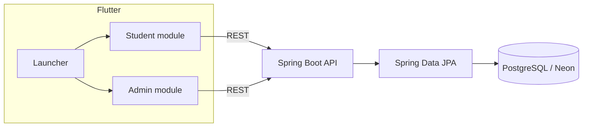

# SHUBUS — System Development & Configuration Documentation

> Technical handover for the SHUBUS workspace. This document follows the supplied SDC reference's detailed organization, while describing the actual repository and respecting the supplied database reference's verification limits.

## Contents

1. [System overview](#1-system-overview)
2. [Repository architecture](#2-repository-architecture)
3. [Technology stack](#3-technology-stack)
4. [Application workflows](#4-application-workflows)
5. [Backend structure](#5-backend-structure)
6. [API inventory](#6-api-inventory)
7. [Database reference and verification status](#7-database-reference-and-verification-status)
8. [Business rules](#8-business-rules)
9. [Configuration and local development](#9-configuration-and-local-development)
10. [Security and operational considerations](#10-security-and-operational-considerations)
11. [Troubleshooting and maintenance](#11-troubleshooting-and-maintenance)
12. [Known gaps and handover checklist](#12-known-gaps-and-handover-checklist)

## 1. System overview

SHUBUS is a campus shuttle reservation and administration system. The current repository contains a combined Flutter launcher with Student and Admin feature modules, plus a Java Spring Boot REST API that uses Spring Data JPA against PostgreSQL hosted on Neon.

The Student module uses a registration number supplied by its host flow to load a profile and interact with transport booking features. The Admin module provides administrative sign-in, dashboard, route and afternoon assignment workflows. Both clients communicate with the backend over HTTP/JSON; persistence is on the shared relational database.



## 2. Repository architecture

```text
frontend/                  Combined Flutter launcher
  lib/main.dart            App entry point and app selection
  lib/app_selection/       Student/Admin entry selection
frontend-student/          Student Flutter package
  lib/features/            Auth, dashboard, routes, bookings, profile, seats
  lib/core/                API client/config, errors, date-window utilities
frontend-admin/             Admin Flutter package
  lib/screens/             Login, dashboard, routes, assignments
  lib/services/            Route API and endpoint configuration
backend/
  src/main/java/com/shubus/backend/
    config/                Security configuration
    controller/            REST endpoints and exception mapping
    dto/                   Request/response objects
    model/                 JPA entities
    repository/            Spring Data repositories
    service/               Workflow and business logic
    util/                  Date, booking, seat and shuttle rules
  src/main/resources/       Configuration example
```

`frontend/pubspec.yaml` uses local path dependencies on the Student and Admin packages. The `frontend/` directory is the runnable combined launcher.

## 3. Technology stack

| Layer | Technology / evidence |
|---|---|
| Student/Admin clients | Flutter and Dart (`^3.11.5`) |
| Client networking | Dart `http` package |
| Backend | Java 21, Spring Boot 4.1.1, Spring MVC, Spring Data JPA |
| Persistence driver | PostgreSQL JDBC |
| Database host | Neon, per supplied database reference |
| ORM schema behavior | `spring.jpa.hibernate.ddl-auto=none` in configuration example |

## 4. Application workflows

### Student

1. Student module receives the registration number from its host/login flow.
2. It loads basic/profile and transport data from `/api/students/{regNo}...` endpoints.
3. It requests available afternoon routes for a date, then requests seats for an assignment.
4. A booking request is submitted; the student can retrieve the booking by date or cancel it.

The backend has distinct services for student authentication, profile lookup, afternoon availability, seat layout/availability, and booking lifecycle. The host-app integration should be reviewed before changing the registration-number handoff.

### Admin

1. Admin credentials are submitted to `/api/admin/auth/login`.
2. The dashboard can request the current operational date and a date-specific overview.
3. Routes and afternoon assignments can be read and maintained through admin APIs.
4. Assignment rules validate type/group and prevent duplicate route/date assignments; shuttle slots are compacted when a shuttle assignment is removed.

The exact authentication/session behavior should be verified in `AdminAuthService` and `SecurityConfig`; a successful login response alone does not imply token-based authorization.

## 5. Backend structure

- **Controllers** map HTTP methods and paths to request/response DTOs and services.
- **Services** implement booking, availability, seat allocation, authentication, route assignment, schedule and dashboard behavior.
- **Repositories** provide JPA persistence access.
- **Models** map Java objects to relational tables/columns.
- **Utilities** centralize operational date, booking window, seat layout and shuttle slot rules.
- **DTOs** define API payloads separately from persistence entities.
- **GlobalExceptionHandler** translates exceptions into HTTP error responses.

Avoid placing business rules in Flutter-only code when those rules affect bookings or data integrity; backend services should remain authoritative.

## 6. API inventory

Current controller mappings include:

| Method | Path | Purpose |
|---|---|---|
| GET | `/api/health` | Health check |
| POST | `/api/admin/auth/login` | Admin login |
| GET | `/api/admin/dashboard/operational-date` | Current operational date |
| GET | `/api/admin/dashboard?date=YYYY-MM-DD` | Date-specific admin summary |
| GET/POST/PUT/DELETE | `/api/admin/routes` and `/api/admin/routes/{id}` | Route management |
| GET/POST/PUT/DELETE | `/api/admin/afternoon-routes` | Assignment management; bulk creation is `/bulk` |
| GET | `/api/admin/schedule` | Admin schedule |
| POST | `/api/auth/login` | Student login |
| GET | `/api/students/{regNo}` | Student details |
| GET | `/api/students/{regNo}/profile` | Student bootstrap profile |
| GET | `/api/students/{regNo}/transport-profile` | Transport profile |
| GET | `/api/students/{regNo}/afternoon-routes?date=...` | Available routes |
| GET | `/api/students/{regNo}/afternoon-routes/{assignmentId}/seats?date=...` | Seat availability |
| POST | `/api/students/bookings` | Create booking |
| GET | `/api/students/{regNo}/bookings?date=...` | Retrieve booking |
| DELETE | `/api/students/{regNo}/bookings/{bookingId}` | Cancel booking |
| GET | `/api/buses` | Bus listing |
| GET | `/api/routes/{routeId}/buses` | Buses assigned to route |
| GET | `/api/registrations/{regNo}` | Registration lookup |

This list is derived from controller source and should be updated when mappings change. Refer to DTOs for exact payload fields.

## 7. Database reference and verification status

The supplied `SHUBUS_COMPLETE_DATABASE_REFERENCE_FOR_CODEX.pdf` explicitly marks its content **PARTIALLY VERIFIED**. It is context, not a complete live schema export. The source code, current Neon catalog and schema migrations (if any) remain the authority for implementation work.

### Confirmed by the supplied catalog notes

- Database engine/host: PostgreSQL on Neon.
- Backend persistence: Spring Boot/JPA.
- Example schema mode: `ddl-auto=none`; tables are expected to exist before startup.
- Six tables were reported in an earlier catalog export: `admin_users`, `afternoon_route_assignments`, `bookings`, `routes`, `student_transport_profiles`, `students`.
- `id` primary keys and several FK/unique constraints were reported in historical catalog notes; verify them in the live catalog before relying on them for schema changes.

### Column inventory reported by the export

| Table | Reported columns and details |
|---|---|
| `admin_users` | `id bigint`, `emp_id varchar`, `password_hash varchar`, `active boolean NOT NULL DEFAULT true` |
| `afternoon_route_assignments` | `id bigint` with sequence default; `route_id bigint`; `assignment_date date`; `assignment_type varchar`; nullable `shuttle_group varchar` |
| `bookings` | `id`, `student_id`, `booking_date date`, `seat_number varchar`, `booked_at timestamp without time zone DEFAULT CURRENT_TIMESTAMP`, `afternoon_assignment_id`; ordinal positions 3, 6 and 8 were missing from the export |
| `routes` | `id` sequence-backed; `route_number`, `route_name`, `ac_type varchar DEFAULT 'NON_AC'`, `allowed_routes varchar[] DEFAULT empty array`, `default_afternoon boolean DEFAULT false`, `route_code` |
| `student_transport_profiles` | `id`, `student_id`, `morning_route_number`, `morning_route_name`, `ac_type`; ordinal position 5 was missing from the export |
| `students` | `id` sequence-backed; `reg_no`, `name`, `password_hash`, `active boolean DEFAULT true`, `gender` |

The PDF says “not present in supplied export” means unknown, not absent in the live database. It also states that defaults are not uniform; do not assume every identifier is generated automatically.

### Relationships and constraints reported historically

- `afternoon_route_assignments.route_id` → `routes.id` (`RESTRICT`).
- `bookings.student_id` → `students.id` (`RESTRICT`).
- `student_transport_profiles.student_id` → `students.id` (`CASCADE`).
- `bookings.afternoon_assignment_id` FK was not confirmed.
- Reported unique rules: admin employee ID, student registration number, one transport profile per student, route number/code, assignment date + route, booking seat per assignment/date, and one student booking per date. Verify live definitions before schema work.

### Unverified database area

The database PDF mentions `buses`, `bus_allowed_routes`, and `mock_bus_registrations` as source-code-referenced tables that were not confirmed by its catalog export. Bus models/controllers/repositories exist in the source. Their actual deployment status and columns require live Neon metadata confirmation. The PDF also records an unresolved `flag` field investigation; do not filter by `flag` or infer its meaning without confirming the live column, API query, and UI path.

### Read-only verification SQL

Use these against the intended database to complete the reference. Do not paste credentials into docs or logs.

```sql
SELECT table_schema, table_name
FROM information_schema.tables
WHERE table_type = 'BASE TABLE'
  AND table_schema NOT IN ('pg_catalog', 'information_schema')
ORDER BY table_schema, table_name;

SELECT table_schema, table_name, ordinal_position, column_name,
       data_type, udt_name, is_nullable, column_default
FROM information_schema.columns
WHERE table_schema NOT IN ('pg_catalog', 'information_schema')
ORDER BY table_schema, table_name, ordinal_position;

SELECT ns.nspname AS schema_name, tbl.relname AS table_name,
       con.conname AS constraint_name, con.contype AS constraint_type,
       pg_get_constraintdef(con.oid, true) AS definition
FROM pg_constraint con
JOIN pg_class tbl ON tbl.oid = con.conrelid
JOIN pg_namespace ns ON ns.oid = tbl.relnamespace
WHERE ns.nspname NOT IN ('pg_catalog', 'information_schema')
ORDER BY ns.nspname, tbl.relname, con.contype, con.conname;
```

For a complete data dictionary, obtain a schema-only export (no rows or secrets) and update this section with live metadata. No production database was accessed as part of this documentation work.

## 8. Business rules

Rules are implemented across `BookingTimeRules`, `OperationalDateRules`, `ShuttleSlotRules`, `SeatLayout`, `BookingService`, `SeatService`, `StudentAfternoonRouteService`, and `AfternoonRouteAssignmentController`.

- Booking windows and operational dates are date/time sensitive; consult utility source rather than duplicating assumptions in clients.
- Seat availability is scoped to a particular assignment and date.
- Student booking uniqueness and seat uniqueness are both enforced by service/database expectations.
- Afternoon assignments distinguish `REGULAR` and `SHUTTLE`; shuttle assignments require a supported group/slot. Controller source defines Alandur slots A1–A5 and Velachery slots V1–V3.
- Route assignments are date-specific and duplicate route/date assignments are rejected.
- Exact cutoffs, seat geometry and timezone should be read from the corresponding utility source; they are intentionally not inferred here.

## 9. Configuration and local development

### Backend

Set environment variables locally:

```text
SHUBUS_DB_URL=jdbc:postgresql://<host>/<database>?sslmode=require
SHUBUS_DB_USERNAME=<username>
SHUBUS_DB_PASSWORD=<password>
```

Then start with Java 21 and the included wrapper:

```powershell
cd backend
.\mvnw.cmd spring-boot:run
```

Default server port in the example is `8081`. Hibernate schema generation is disabled. Keep secrets outside source control.

### Flutter

Configure API base URLs in:

- `frontend-student/lib/core/config/api_config.dart`
- `frontend-admin/lib/services/api_config.dart`

Then:

```powershell
cd frontend
flutter pub get
flutter run
```

Use a device-reachable backend URL; `localhost` from an emulator/device may not refer to the development host.

## 10. Security and operational considerations

- The supplied database reference warns that student flows may use registration-number-based access without token authentication. Verify `SecurityConfig`, controllers and services before deployment; do not treat a caller-supplied registration number as proof of identity.
- Admin login returns an employee ID and active state; inspect the actual security chain and client handling before assuming endpoint protection or a persistent authenticated session.
- Store only password hashes, never plaintext credentials. Do not publish database URLs containing credentials.
- Do not make schema or production data changes based only on this partial reference. Prefer additive, reviewed migrations and a rollback plan.
- Before changing bus filtering, confirm whether a `flag` column exists and what it means.

## 11. Troubleshooting and maintenance

| Symptom | Check |
|---|---|
| Backend cannot connect | Verify DB environment variables, network access, SSL options and that the target Neon database is the intended environment. Do not print secrets. |
| Missing-table/column startup or request error | Compare live schema metadata with JPA entities; `ddl-auto=none` will not create/update tables. |
| Client cannot reach API | Check base URL, port `8081`, emulator/device networking and server bind address. |
| No afternoon routes | Check requested date, student profile, route eligibility and assignments for that operational date. |
| No seats or booking rejected | Check assignment/date, seat layout, booking window and existing booking/seat uniqueness. |
| Admin login succeeds but calls are not protected | Inspect security configuration and current session/token design; response success does not establish authorization. |
| Bus remains visible after changing `flag` | Follow the database PDF investigation: locate live column/table/row, verify environment, identify endpoint/query and compare API response to UI state. |

## 12. Known gaps and handover checklist

- [ ] Replace partial database notes with current schema-only Neon export and verified constraints/indexes.
- [ ] Confirm whether bus-related tables and any `flag` column exist in the deployed database.
- [ ] Verify authentication/authorization behavior for student and admin endpoints before production use.
- [ ] Keep both Flutter API configs aligned with deployment environment.
- [ ] Add actual screenshots and architecture/ER visuals to `docs/` as they become available.
- [ ] Review API payload DTOs whenever endpoint contracts change.

---

**Documentation source note:** The supplied README and SDC reference describe VIT EV Buggy and Firebase/Realtimedatabase behavior. Those project-specific claims were not copied into this SHUBUS documentation because they conflict with the actual workspace. Their general documentation organization and use of visual placeholders informed the presentation only.
